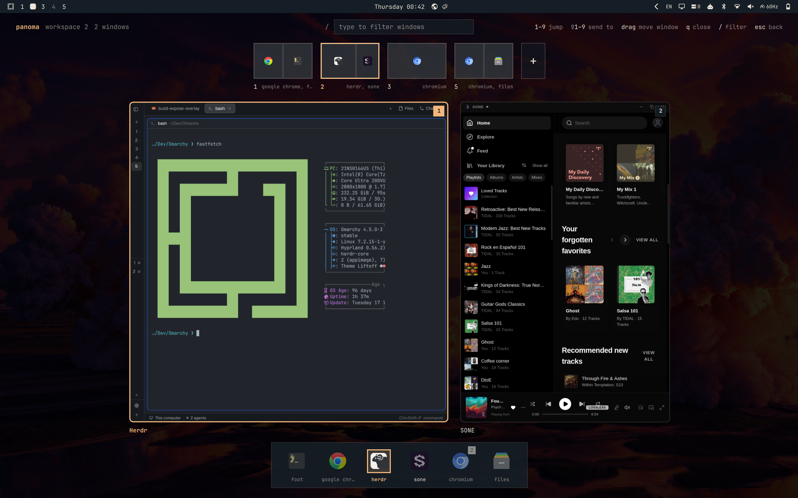

# Panoma



The desktop zooms out: every window on the workspace shrinks out of its real
place into a grid over the wallpaper, and a dock of running apps rises from
the bottom edge. Pick a window and everything flies back, with that one
focused.

- **Super+E** toggles it (configurable, see Settings).
- **Three-finger swipe up** opens it, **down** closes it. With touchpad access
  (below) the overview follows your fingers, the way the workspace swipe does;
  let go past halfway (or flick) and it finishes, otherwise it falls back.
- `1–9` jump · arrows/`hjkl` move · enter focus · `q` close window ·
  `/` filter across all workspaces · tab next app · esc back, then close.
- Click a dock icon to go to that app (its last window, on its workspace);
  right-click it, or press tab, for all of its windows on every workspace.
- **Workspaces** run along the top, each a small map of its windows. Click
  one to go there; **drag a window onto one** (or press `Shift+1–9`) to send
  it there without leaving; drop it on `+` for a fresh workspace.
- **Three fingers sideways** inside Panoma slides to the next or previous
  workspace, following the fingers (Ctrl+←/→ or PageUp/PageDown from the
  keyboard). Wherever you end up is where closing leaves you.

## Settings

The gear at the top right of the overview (or `,`) opens Panoma's settings
over it; every change shows live behind the sheet.

- **Gestures**: 3 or 4 fingers, follow the fingers or just trigger, swipe
  distance (sensitivity), invert the sideways swipe.
- **Look**: background darkness, corners like your windows or square, space
  between windows, animation speed, dock icon size.
- **Show**: workspace strip, dock, key hints, window numbers, and what a click
  on a dock app does (right-click does the other).
- **Keys**: the Hyprland shortcut that opens Panoma (click it, press the
  combination; a combination already in use asks first), the filter / close /
  settings keys inside the overview, and the modifier that sends a window to a
  workspace.

Settings are saved on Panoma's entry in `~/.config/omarchy/shell.json`. From a
terminal: `omarchy-shell panoma get`, `omarchy-shell panoma setting backdrop 0.6`,
`omarchy-shell panoma settingsTab keys`.

### Hyprland

Panoma writes its shortcut, its swipe gestures and the rule that keeps
Hyprland's layer fade off it to `~/.config/hypr/panoma.lua`, rewriting it
whenever those settings change (then it reloads Hyprland, and puts the previous
file back if Hyprland rejects the new one). Hyprland loads it with one line in
`~/.config/hypr/hyprland.lua`, after the other `require`s:

```lua
pcall(require, "hypr.panoma")
```

`pcall` keeps Hyprland happy if Panoma is ever removed. Don't edit
`panoma.lua` by hand; change the settings instead.

## Following the fingers (one-time setup)

Hyprland only reports that a gesture happened, not how far the fingers have
moved, so `swipe-reader.sh` reads the touchpad itself with
`libinput debug-events`. That needs the libinput tools and read access to the
touchpad, and only the touchpad: a udev `uaccess` rule hands the logged-in
user the touchpad node, not the keyboard.

```bash
sudo pacman -S --needed libinput-tools
echo 'ACTION=="add|change", SUBSYSTEM=="input", KERNEL=="event*", ENV{ID_INPUT_TOUCHPAD}=="1", TAG+="uaccess"' \
  | sudo tee /etc/udev/rules.d/70-touchpad-uaccess.rules
sudo udevadm control --reload && sudo udevadm trigger --subsystem-match=input --action=change
```

The shell picks it up within 15 seconds (`omarchy-shell panoma status | jq .swipeReader`
turns `true`). Without it, the swipe gestures in `panoma.lua` still open
and close Panoma, just without tracking the fingers.

To undo: `sudo rm /etc/udev/rules.d/70-touchpad-uaccess.rules` and trigger udev again.

## Trying the motion from a terminal

```bash
omarchy-shell panoma scrub 0.4   # drag to 40%
omarchy-shell panoma release     # let go: settles open or closed
omarchy-shell panoma status | jq
```

`node test.js` checks the layout, filter, morph and swipe parsing.
